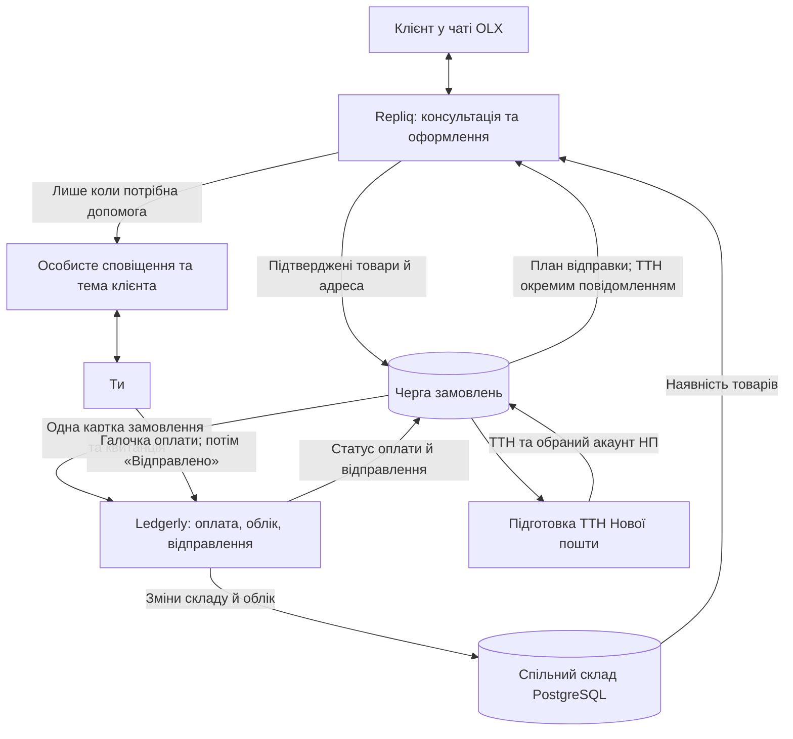

# Як працюють Repliq і Ledgerly

Актуальна схема для версії Repliq **2026.11.10.2**.

Звичайні повідомлення не пересилаються в Telegram навіть у раніше відкритих темах.
Коли потрібна допомога, надходить лише проблемне звернення. Бот продовжує вести
чат, доки ти явно не натиснеш **👤 Я**. Якщо клієнт питає про власника, відповідь:
«Власник відпише, щойно звільниться». Повна історія відкривається лише за твоїм запитом.

Позитивний або негативний відгук приходить тільки власнику в особисті повідомлення
текстом: сам відгук, вкладення, дані діалогу й оголошення та останнього замовлення.
Критика отримує ввічливе вибачення; позитивний відгук — подяку. Режим чату від
відгуку не змінюється. Просте «дякую» не створює сповіщення про відгук.

Питання про параметри коротке: «Напишіть, будь ласка, ваш зріст і вагу».
`1.85` та `1,85` розпізнаються як 185 см; звичні записи `185 78` не потребують уточнення одиниць.

Картка Ledgerly містить пряме посилання на квитанцію в тексті й кнопку її перегляду.
Кнопка **Скасувати** для створеного Repliq замовлення також ставить видалення ТТН
в чергу Нової пошти. Використовується початковий акаунт і Ref цієї накладної.
Накладна в дорозі не видаляється автоматично; результат або потреба ручної
перевірки з’являється в картці. Очікування оплати чи зняття галочки не видаляє ТТН.

## Для клієнта

1. Бот відповідає на запитання про конкретний товар, перевіряє склад, допомагає з розміром на прохання клієнта.
2. Клієнт обирає розмір, колір, кількість та спосіб оформлення. Оформлення не запускається від випадкового «так» поза відповідним питанням.
3. Для звичайної посилки бот надсилає реквізити, просить квитанцію та одним шаблоном збирає ПІБ, телефон, населений пункт і відділення/поштомат.
4. Адреса звіряється з Новою поштою. Клієнт один раз підтверджує повне замовлення та адресу.
5. Замовлення йде в підготовку. Бот продовжує консультацію; для перевірки оплати весь чат тобі не передається.
6. Після твоєї галочки в Ledgerly клієнт отримує план відправки та окремо реальний номер ТТН. Підготовлена накладна не називається вже відправленою посилкою.
7. Нове привітання після оформленого замовлення або явне прохання про новий вибір починає нову консультацію. Попереднє замовлення залишається в окремій історії й не губить оплату або ТТН.

Для OLX Доставки оплата й оформлення залишаються всередині OLX. Ця гілка не створює другу звичайну накладну Нової пошти. Підтвердження замовлення OLX та отримання його накладної ще потребують окремої інтеграції: ця версія не видає їх за автоматизовані.

## Для тебе

**Repliq:** особисте меню «🙋 Потрібен я» показує лише звернення, де потрібна допомога. «💬 Діалоги» дає змогу відкрити будь-якого клієнта. Звичайна консультація зберігається тихо, без автоматичного створення теми для кожного покупця.

Під повідомленнями відкритого діалогу є:

- **auto** — автоматичні відповіді з поточним вибором клієнта.
- **я** — ручна відповідь лише цьому клієнту. Також можна просто написати текст у темі.
- **auto** завершує надсилання прийнятих ручних відповідей і повертає бота, не стираючи замовлення.

Оплата перевіряється в Ledgerly. Старі кнопки інших версій не можуть підтвердити
нове замовлення. `/done` залишається сумісною командою завершення розмови.

Через **40 хвилин без твоїх дій** ручний режим повертається боту. Твоя нова відповідь поновлює цей термін лише в поточному чаті. Бот може обробити останні неотримані відповіді за час цієї ручної розмови; інші старі чати не перечитує для автовідповідей. Пауза та блокування після невідомого результату надсилання автоматично не знімаються.

**Ledgerly:** в одній картці — товари, передоплата, залишок післяплати, одержувач, квитанція, ТТН та акаунт Нової пошти. Спершу перевір кошти й натисни галочку; «Відправлено» — після передачі посилки. Якщо підготовка ТТН затрималася, картка оплати з’явиться раніше й потім оновиться на місці. Повторної перевірки в Repliq немає.

## Що перевірено в стику двох програм

| Ділянка | Правило |
|---|---|
| Каталог і склад | Ledgerly змінює спільний склад; Repliq використовує окремі права читання та сталі ID товарів. |
| Кілька клієнтів | Стан прив’язаний до акаунта OLX, діалогу, покупця й оголошення. Кнопки іншої теми не пересилають відповіді цьому клієнту. |
| Повторні покупки | Консультація відокремлена від попередніх замовлень. Пізня галочка Ledgerly оновлює саме відповідне замовлення. |
| Гроші | Оголошена вартість — повна ціна товарів. Післяплата — ціна мінус 100 грн; при повній оплаті повторного стягнення немає. |
| Квитанція | Вкладення доступне власнику; фото не означає підтвердження надходження грошей. Додавання квитанції не змінює існуючу ТТН. |
| Акаунти НП | Розклад першої/другої половини місяця застосовується лише до нової ТТН. Готова накладна зберігає свій акаунт. |
| Перезапуск і збої | Черга й ручний термін зберігаються. Невідомий результат створення ТТН або надсилання не запускає автоматичний дубль. |
| Навантаження | Перевіряються зміни й активні діалоги. Передача історії в Telegram групується в цитати; цикл оплати не сканує всі чати OLX. |

## Що ще залежить від налаштувань магазину

Потрібен ключ другого акаунта Нової пошти для другої половини місяця, якщо його ще не внесено. Картку для передоплати можна замінити на ФОП-реквізити у приватних налаштуваннях. Обидві програми мають працювати одночасно й бачити той самий файл черги; у новій версії не потрібно вручну створювати нові таблиці.

Огляд охоплює спільний шлях консультації, товарів, оплати, ТТН, передачі в Ledgerly та відправлення. Це не перевірка кожної незалежної функції бухгалтерії Ledgerly.

## Практичний інтерфейс 2026.11.10.2

Актуальні приклади керування, тихі сповіщення, меню «Мої» та стан mono:
[INTERFACE.md](INTERFACE.md). Звичайний текст клієнтської теми є ручною відповіддю;
нотатки позначаються /note. Сам факт підключення власника не змінює облік оплати.
